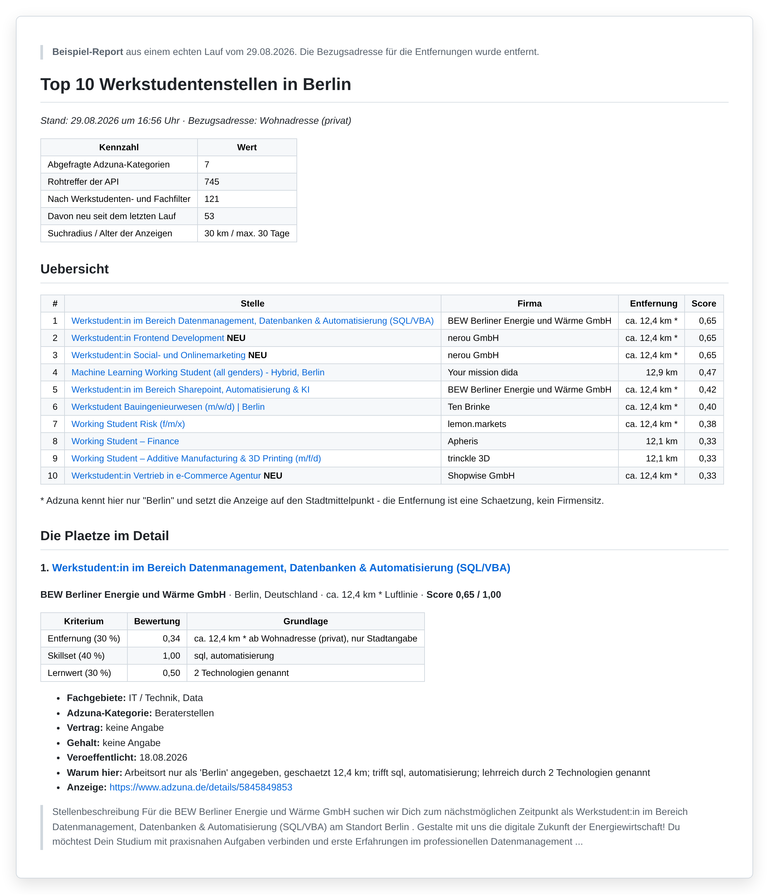
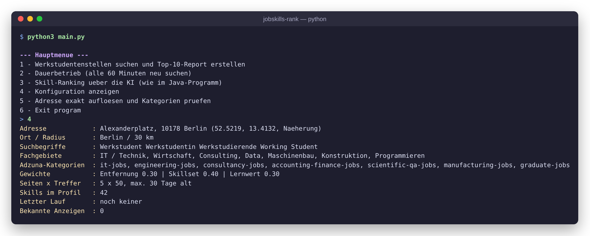

# Jobskills Rank – Stellenanzeigen über APIs auswerten (Java & Python)


Dieses Lernprojekt ruft echte Stellenanzeigen über die **Adzuna Jobs API** ab und wertet sie automatisch aus.
Es gibt zwei Ausbaustufen:

| Version | Frage | Ansatz |
|---------|-------|--------|
| **Java** (`src/`) | *Welche Skills werden für einen Job am häufigsten verlangt?* | Mehrere hundert Anzeigen zu Jobtitel und Ort laden und von **Google Gemini** die 10 meistgenannten Skills ranken lassen |
| **Python** (`python/`) | *Welche Werkstudentenstellen passen am besten zu mir?* | Anzeigen aus mehreren Kategorien sammeln, filtern und nach **Entfernung, Skill-Match und Lernwert** bewerten; Ausgabe als Top-10-Report in Markdown |

Ich wollte in diesem Projekt verstehen, wie man mit **echten REST-APIs** arbeitet: HTTP-Requests bauen,
Parameter URL-kodieren, Ergebnisse seitenweise abrufen (Paging), JSON auf Objekte abbilden, mit Rate-Limits
und Fehlercodes umgehen und API-Keys sicher verwalten.



---

## Java-Version: Skill-Ranking mit KI

1. Die Nutzerin oder der Nutzer gibt im Terminal einen **Jobtitel** und einen **Ort** ein, z. B. *Data Analyst* und *Berlin*.
2. Das Programm fragt die Adzuna-API über `java.net.http.HttpClient` **seitenweise** ab (bis zu 5 Seiten).
3. Die JSON-Antworten werden mit **Gson** auf POJOs abgebildet (`AdzunaPojo` → `List<Job>`).
4. Alle Stellenbeschreibungen gehen gesammelt an **Gemini** (`google-genai` SDK). Gemini liefert ein Ranking der 10 häufigsten, anwendungsnahen Skills zurück.

```
src/main/java/org/example/
├── Main.java        Terminal-Menü
├── Methods.java     API-Abfrage mit Paging, JSON-Parsing, Gemini-Aufruf
├── AdzunaPojo.java  JSON-Template der API-Antwort (Liste von Jobs)
└── Job.java         Eine Stellenanzeige (Beschreibung)
```

## Python-Version: persönliches Job-Ranking

Die Python-Version übernimmt denselben Ablauf (Menü → API mit Paging → Auswertung) und bewertet die Anzeigen
regelbasiert statt per KI:

- **Sammeln:** mehrere Adzuna-Kategorien (IT, Engineering, Consulting, Finance, …) mit je 5 Seiten. Doppelte Anzeigen werden über die Job-ID aussortiert.
- **Filtern:** nur Werkstudentenstellen in den gewünschten Fachgebieten, eine Blockliste für unpassende Treffer.
- **Bewerten:**

  | Kriterium | Gewicht | Grundlage |
  |-----------|---------|-----------|
  | Entfernung | 30 % | Luftlinie per Haversine-Formel ab einer konfigurierbaren Adresse; alle 8 km halbiert sich der Teilscore |
  | Skillset | 40 % | Gewichteter Abgleich mit dem eigenen Skill-Profil; Treffer im Titel zählen stärker |
  | Lernwert | 30 % | Signale wie Mentoring, eigene Projekte, Abschlussarbeit, Vielfalt der Technologien; Abzüge für Dateneingabe, Kaltakquise o. Ä. |

- **Ausgeben:** ein Markdown-Report mit Top-10-Liste, Score-Aufschlüsselung und Begründung je Stelle. Neue Anzeigen seit dem letzten Lauf sind mit **NEU** markiert.
- **Dauerbetrieb:** Mit `--watch 60` sucht das Programm jede Stunde neu.
- **Nur Standardbibliothek:** Die HTTP-Requests laufen über `urllib`, dafür braucht es keine Zusatzpakete.

📄 **[Vollständiger Beispiel-Report](docs/beispiel_report.md)** aus einem echten Lauf (745 Rohtreffer → 121 passende Stellen → Top 10)



Mehr Details zu Aufbau und Stellschrauben stehen in [`python/README.md`](python/README.md).

## API-Keys einrichten

Das Projekt braucht **eigene, kostenlose API-Keys**. Aus Sicherheitsgründen liegen keine Keys im Repository.
Das Programm liest sie aus Umgebungsvariablen:

| Variable | Wofür | Woher |
|----------|-------|-------|
| `ADZUNA_APP_ID` | Adzuna Jobs API (beide Versionen) | kostenlos auf [developer.adzuna.com](https://developer.adzuna.com/) registrieren |
| `ADZUNA_APP_KEY` | Adzuna Jobs API (beide Versionen) | ebenda |
| `GOOGLE_API_KEY` | Gemini (Java-Version; Python-Menüpunkt 3) | kostenlos im [Google AI Studio](https://aistudio.google.com/apikey) |
| `HOME_ADDRESS` | *optional:* Bezugsadresse für die Entfernung (Python) | eigene Adresse; Standard ist der Alexanderplatz |

Im Terminal (macOS/Linux) für die aktuelle Sitzung setzen:

```bash
export ADZUNA_APP_ID="deine-app-id"
export ADZUNA_APP_KEY="dein-app-key"
export GOOGLE_API_KEY="dein-gemini-key"
```

Eine Vorlage liegt in [`.env.example`](.env.example). In IntelliJ trägt man die Variablen in der Run-Konfiguration
unter *Environment variables* ein.

## Installation und Start

```bash
git clone https://github.com/Gregor5499/jobskills-rank.git
cd jobskills-rank
```

**Java-Version** (JDK 25, Maven 3.9+):

```bash
mvn -q compile exec:java -Dexec.mainClass=org.example.Main
```

**Python-Version** (Python 3.9+):

```bash
cd python
python3 main.py              # Menü
python3 main.py --once       # ein Durchlauf, Report schreiben
python3 main.py --watch 60   # alle 60 Minuten neu suchen

pip install google-genai     # nur für Menüpunkt 3 (KI-Skillranking)
```

Die Reports landen in `python/reports/`. Dieser Ordner wird nicht ins Repository übernommen.

## Grenzen

- Adzuna liefert pro Anzeige nur etwa **500 Zeichen** Beschreibung. Skill-Match und Lernwert beruhen also auf einem Ausschnitt.
- Viele Anzeigen nennen nur „Berlin“ als Ort. Adzuna setzt sie dann auf den Stadtmittelpunkt, die Entfernung ist in diesen Fällen geschätzt (im Report mit `*` markiert).
- Das Skill-Ranking der Java-Version hängt vom KI-Modell ab und ist daher nicht exakt reproduzierbar.

## Autor

**Gregor Arlt** – Wirtschaftsingenieurwesen (B.Sc.), TU Berlin
